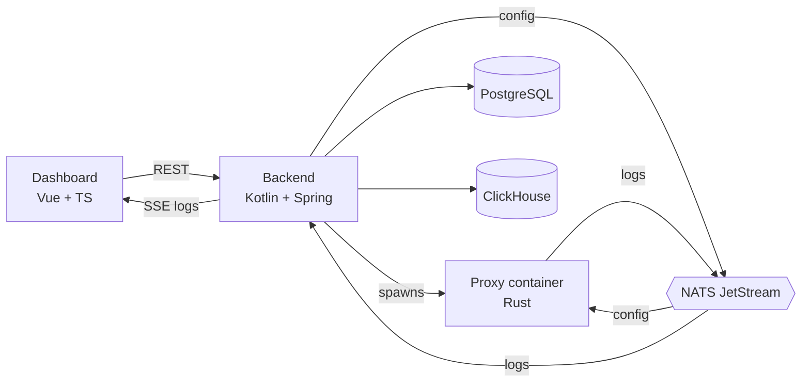

# Proxyma

> *Always near, always here.*


**Proxyma is a reverse proxy you don't have to babysit.**

Sign up, create an organisation, and you get your own proxy instance, running in its own container, ready to be configured from a web dashboard. No servers to set up, no config files to hand-edit, no digging through terminals to see what's going on. Set up your rate limits and routes, then watch the traffic roll in live.

<sub>The name comes from the Latin *proxima* ("nearest"). That's the idea: a proxy that's always close to you and always ready.

## Who is this for?

Small teams and solo developers who want a proxy without the setup overhead. It's built around simplicity and accessibility.

It is **not** meant to be a production-scale proxy. It's a backend-focused project that keeps the proxy itself small on purpose. If you need to handle millions of requests per second, you want something else. If you want something that just works and is easy to understand, hi, welcome.

## Features

Legend: ✅ done · 🚧 in progress · 📝 planned

### The proxy
- 📝 **Rate limiting**: keep traffic in check
- 📝 **API mapping**: route incoming paths to your upstream services
- 📝 **Automatic IP blocking**: break a rule and your IP gets blocked
- 📝 **Basic malicious byte-sequence detection**: catches the obvious nasties
- 📝 **Zero-downtime config changes**: new settings apply instantly, with no restart and no dropped requests

### The platform
- 📝 **One isolated proxy per organisation**: each org gets its own container
- 📝 **Web dashboard**: configure the proxy and watch it work
- 📝 **Live log stream**: see requests as they happen
- 📝 **Teams**: invite people to your org and manage the proxy together
- 📝 **Roles**: owner, co-owner and member
- 📝 **Audit trail**: every action inside an org is recorded, so you always know who changed what

## Roles

Every organisation has an owner, and the owner can bring in others.

| | Member | Co-owner | Owner |
|---|---|---|---|
| View proxy config | ✅ | ✅ | ✅ |
| Edit proxy config | ✅ | ✅ | ✅ |
| View live logs | ✅ | ✅ | ✅ |
| View audit trail | ✅ | ✅ | ✅ |
| Invite / remove people | ❌ | ✅ | ✅ |
| Assign roles | ❌ | ✅ | ✅ |
| Delete the organisation | ❌ | ❌ | ✅ |

Each account can create one organisation. Every action taken inside an org is audited.

## How it works

1. You create an organisation on the website.
2. The backend spins up a fresh Docker container running your own Proxyma proxy.
3. When you change the config in the dashboard, the backend saves it and pushes it to your proxy.
4. Your proxy sends its logs back to the backend, which streams them live to your browser.



The details live in [`docs/architecture.md`](docs/architecture.md).

## Tech stack

| Part | Tech | Why |
|---|---|---|
| Proxy | Rust | Fast, small and safe for something that sits in front of traffic |
| Backend | Kotlin + Spring (JDK 21) | Manages orgs, users, containers and config |
| Dashboard | Vue + TypeScript + Vite | Lightweight, quick to iterate on |
| Messaging | NATS JetStream | Durable delivery of config and logs between backend and proxies |
| App data | PostgreSQL | Users, orgs, roles, config, audit trail |
| Logs | ClickHouse | Built for append-heavy log data |
| Live logs | Server-Sent Events | One-way streaming, simpler and cheaper than WebSockets |
| Isolation | Docker | One container per organisation |

## Getting started

> Proxyma is still in the design stage, so there's nothing to run yet. This section will be filled in as things get built.

**You'll need:**
- JDK 21
- Bun (for the dashboard, via Vite)
- Rust and Cargo
- Docker (the backend uses it to spawn proxy containers)

**Planned steps:**

1. Start the supporting services (PostgreSQL, ClickHouse, NATS)
```bash
docker compose up -d
```
2. Run the backend
```bash
cd backend
./gradlew bootRun
```
3. Run the dashboard
```bash
cd frontend
bun install
bun run dev
```
4. Build the proxy image
```bash
docker build -t proxyma-proxy ./proxy
```
5. Open the dashboard (by default at `http://localhost:5173`), create an organisation, and you're in. The backend will spawn your proxy container from the image you just built.

## Repository structure

```
proxyma/
├── proxy/      # The reverse proxy (Rust)
├── backend/    # Orgs, users, containers, config and logs (Kotlin + Spring)
├── frontend/   # The dashboard (Vue + TypeScript + Vite)
└── docs/       # Architecture, design decisions and more
```

## Documentation

The deeper stuff lives in [`docs/`](docs/):

- [Architecture](docs/architecture.md): how the pieces talk to each other
- [Design decisions](docs/design-decisions.md): why things are built the way they are, and the trade-offs
- [Security and isolation](docs/security.md): how orgs are kept apart
- [Proxy configuration](docs/proxy-config.md): everything you can configure
- [API reference](docs/api.md): backend endpoints
- [Roadmap](docs/roadmap.md): what's planned

## Roadmap

- [ ] Proxy core: reverse proxying and API mapping
- [ ] Rate limiting and automatic IP blocking
- [ ] Basic malicious byte-sequence detection
- [ ] Backend: auth, organisations, roles, container spawning
- [ ] Dashboard with live logs and audit trail

Details are in [`docs/roadmap.md`](docs/roadmap.md).

## Contributing

Small contributions on the existing stuff are welcome once the project is off the ground. Until then, feel free to open an issue with ideas or questions.

## License

[MIT](LICENSE)
