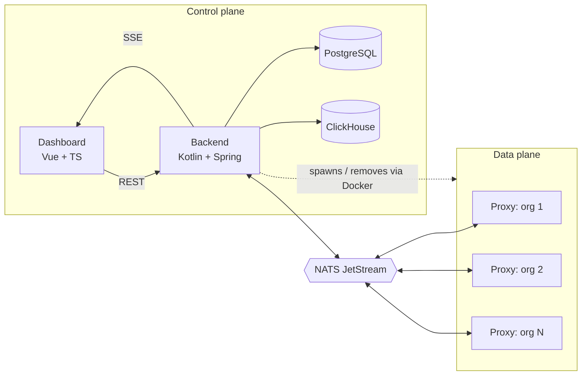
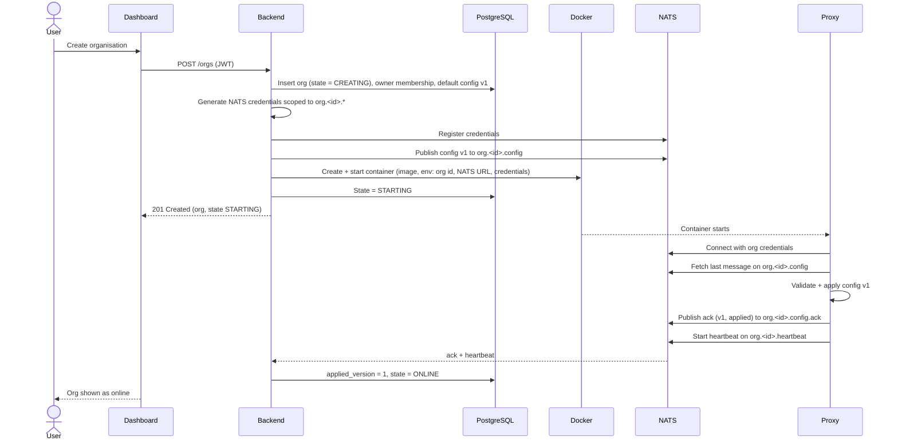
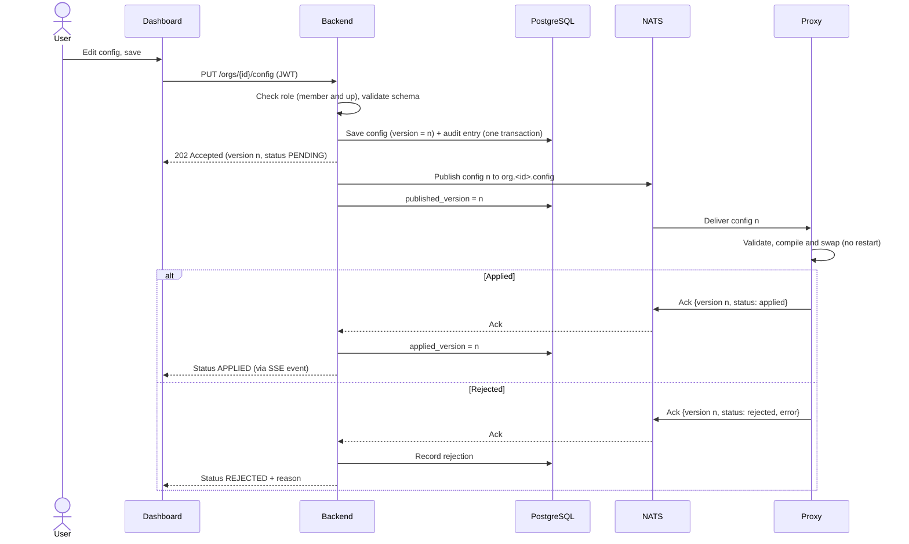
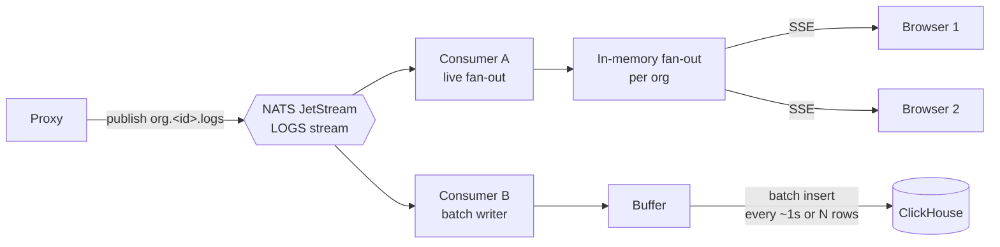
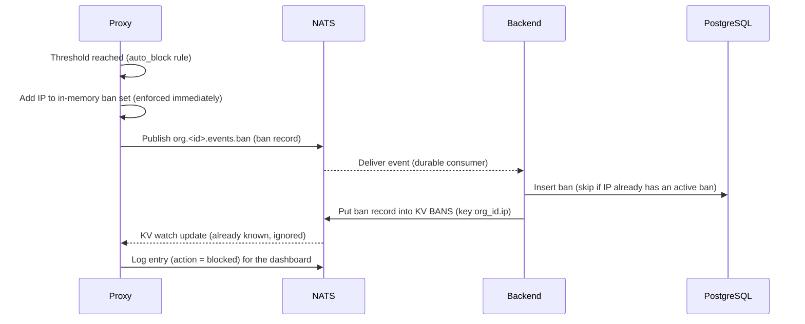
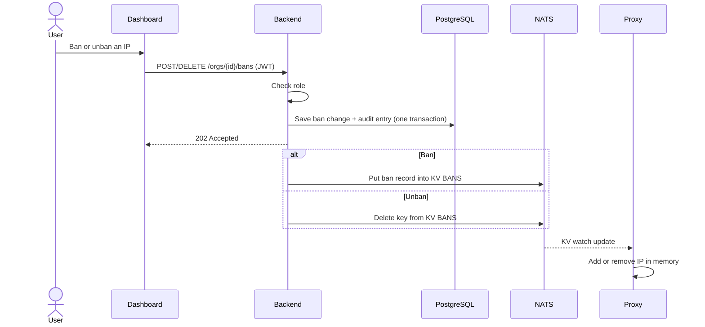
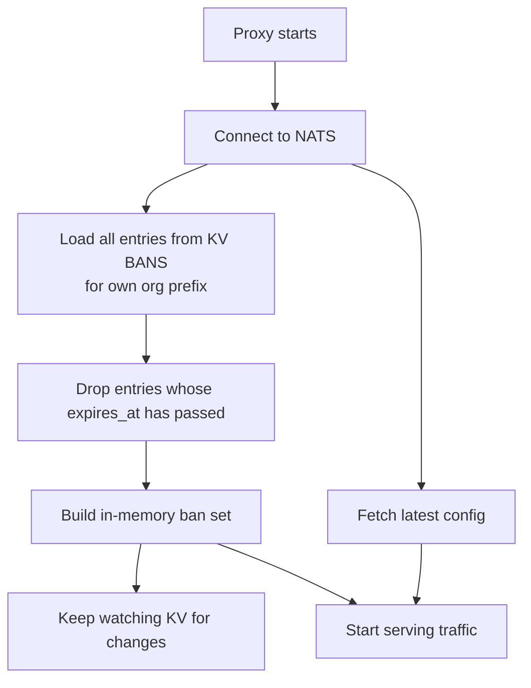
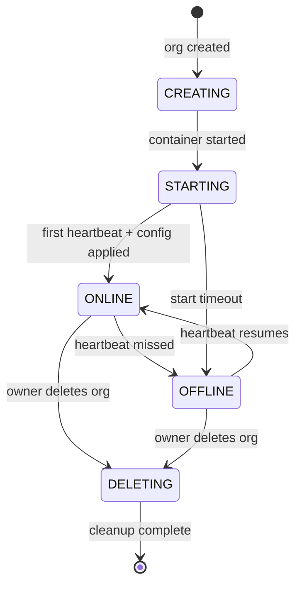
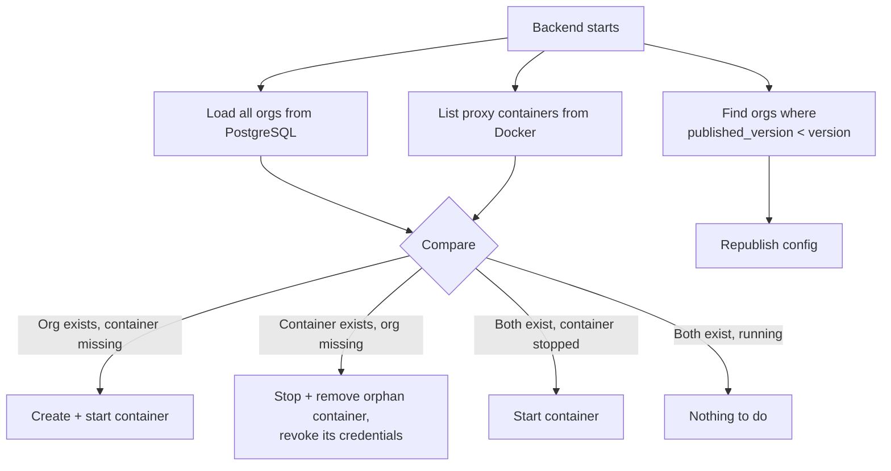

# Architecture

> Status: design stage. Everything below describes the intended design, not working code.

## 1. Overview

Proxyma is split into a **control plane** and a **data plane**.

- The **control plane** (dashboard, backend, PostgreSQL, ClickHouse) manages users, organisations, configuration and logs.
- The **data plane** (one Rust proxy container per organisation) handles the actual traffic.
- **NATS JetStream** is the only channel between the two. The backend never calls a proxy directly, and a proxy never talks to a database.



## 2. Components

| Component | Owns | Never does |
|---|---|---|
| **Dashboard** | UI, session handling (JWT), rendering the live log stream | Talks to NATS, Docker or any database directly |
| **Backend** | Auth, orgs, roles, audit trail, config validation and versioning, container lifecycle, log ingestion, SSE fan-out, ban records and their delivery, platform administration | Handles proxied traffic, give admins access to config, logs or ban IPs |
| **Proxy** | Reverse proxying, rate limiting, API mapping, enforcing IP bans from an in-memory set, reporting automatic bans, byte-sequence detection, emitting logs, acknowledging config, applying config without restart (atomic swap) | Reads or writes a database, talks to other orgs' subjects |
| **NATS JetStream** | Durable delivery of config, logs, acks and heartbeats, bans (KV) | Stores anything long-term |
| **PostgreSQL** | Users, orgs, memberships, roles, config (with versions), audit trail, bans | Stores logs |
| **ClickHouse** | Request logs (history and search), with a 30-day TTL | Serves the live view or stores relational state |

## 3. Flow: organisation creation

The backend creates the org, generates scoped NATS credentials, spawns the container, and waits for the proxy to come online.



The org's initial config is published *before* the container starts. Because JetStream keeps the last message per subject, the proxy finds it waiting no matter how fast or slow it boots.

If any step fails, the org stays in `CREATING` or `STARTING`, and the reconciliation loop (see section 6) cleans up or retries.

## 4. Flow: config update

Postgres is the source of truth. NATS is the delivery mechanism. Each org's config carries three version numbers:

| Field | Meaning |
|---|---|
| `version` | Latest saved config |
| `published_version` | Latest version successfully published to NATS |
| `applied_version` | Latest version the proxy confirmed it applied |



**Why this order?** The config and its audit entry are written in a single Postgres transaction, and only then is NATS contacted. If NATS is down or the publish fails, nothing is lost, because the config is saved and `published_version < version` tells the backend what is still owed.

**Retries.** A scheduled job in the backend republishes any org where `published_version < version`, with backoff. Publishing is idempotent, since the proxy ignores any version lower than or equal to the one it already runs.

**What the dashboard shows:**

| Condition | Status |
|---|---|
| `applied_version == version` | Applied |
| `applied_version < version`, no rejection | Pending |
| Proxy rejected version `version` | Rejected, with the proxy's error message |
| Proxy offline | Pending (and the org shows as offline) |

`Applied` means the new config has been swapped in. Requests already in progress finish on the previous version.

If a config is rejected, the proxy keeps running its last good config. Rejected versions are never half-applied.

## 5. Flow: log pipeline

Logs take two independent paths from the same stream: a fast path for the live view, and a batched path for history.



**Live path.** The backend subscribes to the org's log subject and pushes entries to every browser currently watching that org. It does not wait for ClickHouse. Before opening a stream, the backend checks the user's JWT and org membership.

**History path.** A separate consumer buffers entries and inserts them into ClickHouse in batches (every second or every few thousand rows, whichever comes first). ClickHouse performs best with batched inserts, so the backend never inserts row by row.

**Reconnects.** SSE reconnects automatically. Since the live path is not replayable, the dashboard fills any gap after a reconnect by querying ClickHouse for entries newer than the last one it received. Use the log entry's ID as the SSE event ID so the browser sends `Last-Event-ID` on reconnect.

**Log entry shape (draft):**

| Field | Example |
|---|---|
| `id` | Unique, time-ordered |
| `org_id` | Org identifier |
| `timestamp` | Request time |
| `client_ip` | Caller's IP |
| `method`, `path`, `status` | `GET`, `/api/users`, `200` |
| `upstream` | Which mapped upstream handled it |
| `latency_ms` | Time spent proxying |
| `action` | `allowed`, `rate_limited`, `blocked`, `malicious` |
| `rule` | Which rule triggered the action, if any |
| `config_version` | Config version the request ran under |

**ClickHouse table (sketch):**

```sql
CREATE TABLE logs (
    org_id         UUID,
    timestamp      DateTime64(3),
    id             String,
    client_ip      String,
    method         LowCardinality(String),
    path           String,
    status         UInt16,
    upstream       String,
    latency_ms     UInt32,
    action         LowCardinality(String),
    rule           String,
    config_version UInt64
)
ENGINE = MergeTree
PARTITION BY toYYYYMM(timestamp)
ORDER BY (org_id, timestamp)
TTL toDateTime(timestamp) + INTERVAL 30 DAY;
```

Logs are kept for **30 days**, enforced by the table's TTL. Ordering by `org_id` first keeps one org's logs together, so per-org queries stay fast.

**Delivery guarantee.** Logs are at-least-once. A backend crash between consuming and inserting can cause a few duplicate entries, which the `id` field lets queries de-duplicate if it ever matters. Occasional duplicates are acceptable for logs.

## 6. Flow: IP bans

### Design in one paragraph

**PostgreSQL is the source of truth for bans. JetStream delivers them. The proxy keeps an in-memory copy for fast lookups, but that copy is rebuilt from JetStream on every start, so a restart never loses a ban.** The proxy still never talks to a database. It only talks to NATS, exactly like config.

### Why not let the proxy read the database?

| Option | Verdict |
|---|---|
| Proxy connects to PostgreSQL | Breaks the data-plane/control-plane split. Every proxy would need database credentials, a compromised proxy could reach other orgs' rows, and the proxy would need a connection pool and polling logic. |
| Proxy keeps bans only in memory | Bans vanish on restart, so an attacker can reset a ban by crashing the proxy. This is the flaw we're fixing. |
| **Bans delivered over NATS, persisted by the backend** | Same pattern as config. Durable, isolated per org, no new dependency for the proxy. **Chosen.** |

### Components involved

| Piece | Role |
|---|---|
| **PostgreSQL `bans` table** | Source of truth. Holds every ban with who or what caused it, why, when, and when it expires. |
| **JetStream KV bucket `BANS`** | A durable "current bans" map. Key: `<org_id>.<ip>` (with `:` replaced by `_` for IPv6). Value: the ban record. The bucket is written **only by the backend**. A KV bucket is a JetStream stream that keeps the last value per key, which is the same mechanism config already uses. |
| **Subject `org.<id>.events.ban`** | Proxy → Backend. Used by the proxy to report an automatic ban. |
| **Proxy in-memory set** | Fast lookups on every request. Rebuilt from the KV bucket on start and kept current by watching it. |

**Ban record** (the value stored in KV and mirrored in Postgres):

```json
{
  "ip": "198.51.100.23",
  "source": "auto",
  "reason": "10 rate-limit violations in 60s",
  "rule": "rate_limit_exceeded",
  "created_by": null,
  "created_at": "2026-10-17T12:00:00Z",
  "expires_at": "2026-10-17T12:15:00Z"
}
```

`expires_at: null` means permanent until someone lifts it. `created_by` is a user ID for manual bans and `null` for automatic ones.

**`bans` table (sketch):**

| Column | Notes |
|---|---|
| `id` | Primary key |
| `org_id` | Owning org |
| `ip` | Single IP address (CIDR bans are not in the MVP) |
| `source` | `auto` or `manual` |
| `reason`, `rule` | Why |
| `created_by` | User ID, or null for auto |
| `created_at`, `expires_at` | Timing |
| `removed_at`, `removed_by` | Set when lifted early |

A ban is **active** if `removed_at` is null and (`expires_at` is null or in the future).

### Flow 1: automatic ban

The proxy bans immediately in memory, because enforcement can't wait for a network round trip. It then reports the ban so it can be made durable.



If the backend is down, the event waits in JetStream and is handled when the backend returns. The proxy keeps enforcing the ban from memory in the meantime.

### Flow 2: manual ban and unban



Same order as config: Postgres first (with the audit entry), then NATS. If the NATS step fails, the reconciliation job below repairs it.

### Flow 3: proxy start or restart



The proxy only starts serving traffic **after** it has loaded both its config and its bans, so a restart never opens a window where a banned IP gets through.

### Expiry

- The proxy checks `expires_at` itself on every lookup, so an expired ban stops applying at the right moment even if nothing else has happened yet.
- A scheduled backend job removes expired entries from KV and keeps the Postgres rows as history. This keeps the bucket small.

### Reconciliation

The existing reconciliation loop gets one more duty. For each org, the backend compares **active bans in PostgreSQL** with **entries in KV**:

| Mismatch | Fix |
|---|---|
| Active in Postgres, missing in KV | Put it into KV |
| In KV, not active in Postgres (lifted or expired) | Delete it from KV |
| Auto-ban event received but not yet persisted | Process the event (it is in JetStream) |

**PostgreSQL wins every disagreement.** KV is a delivery copy and can be rebuilt from Postgres at any time, so losing the bucket costs nothing permanent.

### Limits

| Limit | Value |
|---|---|
| Active bans per org | 10,000 (keeps memory and KV size bounded; auto-block stops creating new bans once reached, and logs a warning) |
| Ban duration | Up to 30 days, or permanent |
| Ban targets | Single IP addresses (IPv4 and IPv6) |

## 7. Flow: proxy lifecycle

### States



- **Heartbeat.** Each proxy publishes a small message on `org.<id>.heartbeat` at a fixed interval (for example every 5 seconds). If the backend hasn't seen one for a few intervals, the org is marked `OFFLINE`. It includes the proxy's current `config_version`.
- **Restart policy.** Containers are created with a Docker restart policy (`unless-stopped`), so Docker brings a crashed proxy back on its own.

### Proxy crash

A restarted proxy reconnects to NATS and fetches the last message on its config subject. It resumes with the latest saved config, not a stale or empty one, and starts sending heartbeats again.

### Backend restart (reconciliation)

On startup, and then periodically, the backend compares the database with what Docker is actually running, the loop also reconciles bans between PostgreSQL and the BANS bucket:



Because the proxy's config lives in JetStream and Postgres, the backend can be down for a while without affecting running proxies. Traffic keeps flowing, and only config changes and the live log view are unavailable. Logs published meanwhile are retained by JetStream and processed when the backend returns.

### Organisation deletion

Only the owner can delete an organisation. The backend:

1. Sets the state to `DELETING` and records an audit entry.
2. Stops and removes the container.
3. Revokes the org's NATS credentials and removes its stream data.
4. Deletes the org's config, memberships and invitations from PostgreSQL.
5. Leaves the org's logs to expire through the ClickHouse TTL (up to 30 days). They are no longer reachable through the dashboard.

If the backend crashes midway, the org stays in `DELETING` and the reconciliation loop finishes the job.

## 8. NATS subject layout

The subject prefix doubles as the isolation boundary: every org owns everything under `org.<id>.`

| Subject | Direction | Purpose | Persistence |
|---|---|---|---|
| `org.<id>.config` | Backend → Proxy | Config updates | JetStream, last message per subject kept |
| `org.<id>.config.ack` | Proxy → Backend | Applied / rejected confirmation | JetStream, short retention |
| `org.<id>.logs` | Proxy → Backend | Request log entries | JetStream, limited retention |
| `org.<id>.heartbeat` | Proxy → Backend | Liveness signal | Plain NATS, no persistence needed |
| `org.<id>.events.ban` | Proxy → Backend | Report an automatic ban | JetStream stream `EVENTS`, limits-based retention, durable backend consumer |
| KV `BANS`, key `<org_id>.<ip>` | Backend writes, Proxy reads and watches | Current bans | JetStream KV, last value per key |

**Streams:**

| Stream | Subjects | Retention |
|---|---|---|
| `CONFIG` | `org.*.config` | Max 1 message per subject, so it always holds the latest config |
| `ACKS` | `org.*.config.ack` | Short, by age |
| `LOGS` | `org.*.logs` | Limits-based (age and size), enough to survive a backend outage |
| `EVENTS` | `org.*.events.ban` | Limits-based |

**Consumers:**

- Each **proxy** uses a consumer filtered to its own `org.<id>.config` subject, starting from the last message.
- The **backend** uses durable consumers for `LOGS` (one for live fan-out, one for the ClickHouse writer) and for `ACKS`, so nothing is lost if it restarts.

**Permissions per credential:**

| Principal | May publish | May subscribe |
|---|---|---|
| Proxy for org `X` | `org.X.logs`, `org.X.config.ack`, `org.X.heartbeat`, `org.X.events.ban` | `org.X.config`, Read and watch only keys starting with `X.` in `BANS` |
| Backend | `org.*.config`, Write to all `BANS` keys | `org.*.logs`, `org.*.config.ack`, `org.*.heartbeat`, `org.*.events.ban` |

A proxy's credentials grant no access outside its own prefix (plus the JetStream API calls needed for its own consumer). Org A's proxy therefore cannot read org B's config or write into B's logs. Implementation details on how the backend registers credentials with NATS belong in [`security.md`](security.md).

## 9. Data ownership

| Data | Store | Notes |
|---|---|---|
| Users, credentials | PostgreSQL | Suspension status, admin flag, passwords hashed |
| Organisations, state | PostgreSQL | One per user account |
| Memberships, roles | PostgreSQL | Owner, co-owner, member |
| Invitations | PostgreSQL | |
| Proxy config + versions | PostgreSQL | Source of truth |
| Audit trail | PostgreSQL | Written in the same transaction as the change it records |
| Request logs | ClickHouse | 30-day TTL |
| In-flight config, acks, recent logs | NATS JetStream | Transient delivery, not a record |
| Blocked-IP list | PostgreSQL (truth), JetStream KV (delivery copy) | Proxy keeps an in-memory copy, rebuilt on every start |
| Platform audit trail | PostgreSQL | Separate from per-org audit trails, append-only |

Admin endpoints read only PostgreSQL, and never ClickHouse or NATS content. This keeps config and logs out of admin reach by construction, not just by policy.

## 10. Failure behaviour

| What fails | What happens |
|---|---|
| **Proxy container crashes** | Docker restarts it. It fetches the latest config from JetStream and resumes. The dashboard shows `OFFLINE` until heartbeats resume. Rate-limit counters are reset. Bans are reloaded from the `BANS` bucket before it serves traffic. |
| **Backend down** | Proxies keep serving traffic with their current config. Logs queue in JetStream. Config edits and the dashboard are unavailable until it returns. |
| **NATS down** | Proxies keep serving traffic with their current config. Config edits are saved to PostgreSQL and republished once NATS returns. Logs generated during the outage may be lost, since the proxy has nowhere to send them. A small in-memory buffer in the proxy can soften this. Existing bans keep being enforced from memory. New automatic bans are enforced but can't be reported until NATS returns. |
| **PostgreSQL down** | Login, config edits and role changes fail. Automatic bans are still enforced by the proxy and queued for the backend. Proxies are unaffected. |
| **ClickHouse down** | The live view still works. History inserts retry, and JetStream holds entries until its retention limit. Older history is unavailable meanwhile. |
| **Docker daemon down** | Running proxies are unaffected if they're already up, but org creation, deletion and reconciliation fail until Docker is back. |
| **Proxy rejects a config** | The proxy keeps its last good config. The dashboard shows `REJECTED` with the reason. |
| **Publish to NATS fails after a save** | The config is saved with `published_version < version`. A retry job republishes it. |

## 11. Known limitations

- The backend needs access to the Docker socket, which is powerful. This is accepted for a local, non-public deployment and is covered in [`security.md`](security.md).
- Logs are at-least-once, so duplicates are possible. Logs can also be lost if NATS is unreachable for long.
- Rate-limit counters and live in a single proxy's memory and are lost on restart.
- One proxy instance per org means no horizontal scaling and no failover.
- Only a single backend instance is supported. Running several would need coordination for reconciliation and the retry job.
- If a proxy auto-bans an IP and **restarts before the backend has processed the ban event** (backend down or lagging), the restarted proxy won't know about that ban until the backend catches up and writes it to KV. The ban event is not lost, only delayed. For this project's scope, that's an accepted trade-off in exchange for the backend being the only writer.
