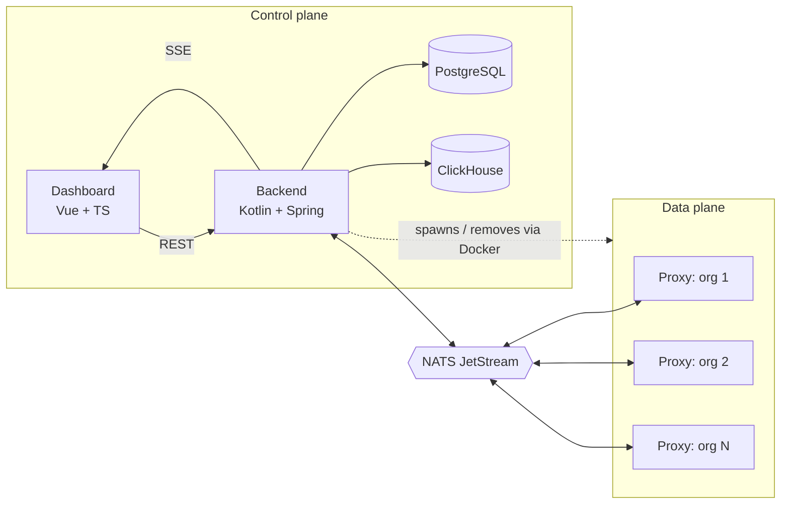
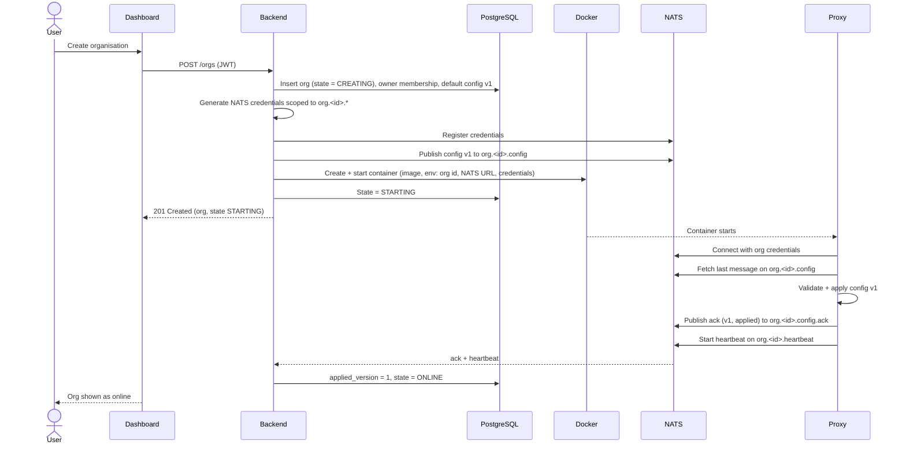
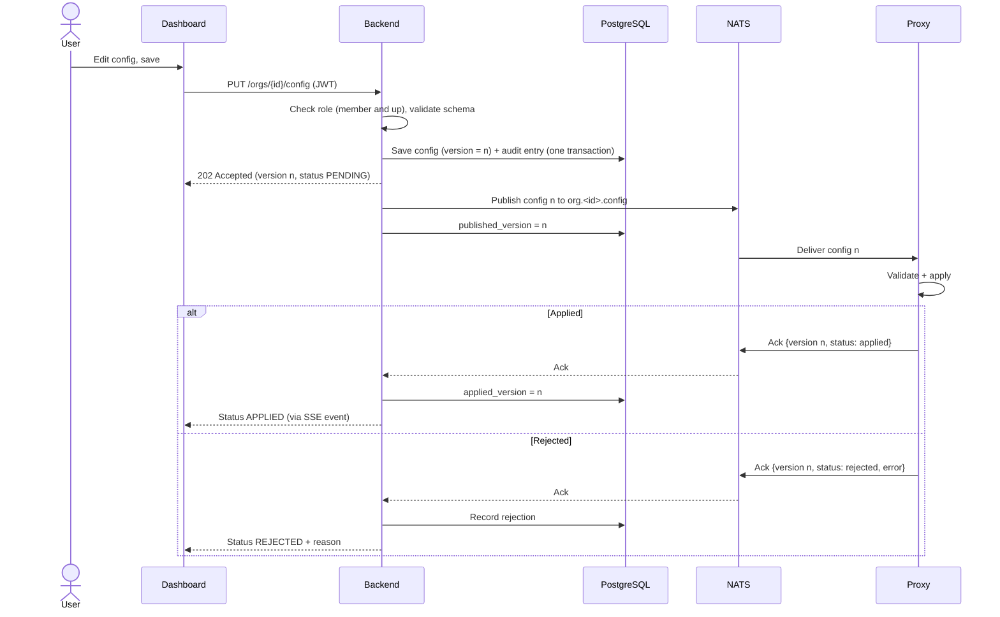
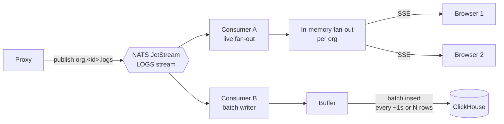
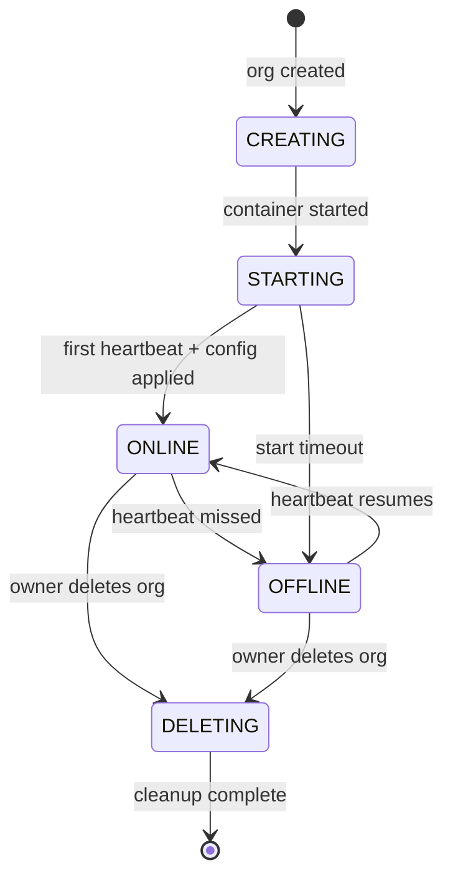
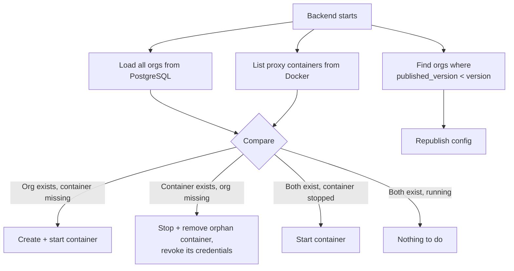

# Architecture

> Status: design stage. Everything below describes the intended design, not working code.

## 1. Overview

Proxyma is split into a **control plane** and a **data plane**.

- The **control plane** (dashboard, backend, PostgreSQL, ClickHouse) manages users, organisations, configuration and logs.
- The **data plane** (one Rust proxy container per organisation) handles the actual traffic.
- **NATS JetStream** is the only channel between the two. The backend never calls a proxy directly, and a proxy never talks to a database.



## 2. Components

| Component | Owns | Never does |
|---|---|---|
| **Dashboard** | UI, session handling (JWT), rendering the live log stream | Talks to NATS, Docker or any database directly |
| **Backend** | Auth, orgs, roles, audit trail, config validation and versioning, container lifecycle, log ingestion, SSE fan-out | Handles proxied traffic |
| **Proxy** | Reverse proxying, rate limiting, API mapping, IP blocking, byte-sequence detection, emitting logs, acknowledging config | Reads or writes a database, talks to other orgs' subjects |
| **NATS JetStream** | Durable delivery of config, logs, acks and heartbeats | Stores anything long-term |
| **PostgreSQL** | Users, orgs, memberships, roles, config (with versions), audit trail | Stores logs |
| **ClickHouse** | Request logs (history and search), with a 30-day TTL | Serves the live view or stores relational state |

## 3. Flow: organisation creation

The backend creates the org, generates scoped NATS credentials, spawns the container, and waits for the proxy to come online.



The org's initial config is published *before* the container starts. Because JetStream keeps the last message per subject, the proxy finds it waiting no matter how fast or slow it boots.

If any step fails, the org stays in `CREATING` or `STARTING`, and the reconciliation loop (see section 6) cleans up or retries.

## 4. Flow: config update

Postgres is the source of truth. NATS is the delivery mechanism. Each org's config carries three version numbers:

| Field | Meaning |
|---|---|
| `version` | Latest saved config |
| `published_version` | Latest version successfully published to NATS |
| `applied_version` | Latest version the proxy confirmed it applied |



**Why this order?** The config and its audit entry are written in a single Postgres transaction, and only then is NATS contacted. If NATS is down or the publish fails, nothing is lost, because the config is saved and `published_version < version` tells the backend what is still owed.

**Retries.** A scheduled job in the backend republishes any org where `published_version < version`, with backoff. Publishing is idempotent, since the proxy ignores any version lower than or equal to the one it already runs.

**What the dashboard shows:**

| Condition | Status |
|---|---|
| `applied_version == version` | Applied |
| `applied_version < version`, no rejection | Pending |
| Proxy rejected version `version` | Rejected, with the proxy's error message |
| Proxy offline | Pending (and the org shows as offline) |

If a config is rejected, the proxy keeps running its last good config. Rejected versions are never half-applied.

## 5. Flow: log pipeline

Logs take two independent paths from the same stream: a fast path for the live view, and a batched path for history.



**Live path.** The backend subscribes to the org's log subject and pushes entries to every browser currently watching that org. It does not wait for ClickHouse. Before opening a stream, the backend checks the user's JWT and org membership.

**History path.** A separate consumer buffers entries and inserts them into ClickHouse in batches (every second or every few thousand rows, whichever comes first). ClickHouse performs best with batched inserts, so the backend never inserts row by row.

**Reconnects.** SSE reconnects automatically. Since the live path is not replayable, the dashboard fills any gap after a reconnect by querying ClickHouse for entries newer than the last one it received. Use the log entry's ID as the SSE event ID so the browser sends `Last-Event-ID` on reconnect.

**Log entry shape (draft):**

| Field | Example |
|---|---|
| `id` | Unique, time-ordered |
| `org_id` | Org identifier |
| `timestamp` | Request time |
| `client_ip` | Caller's IP |
| `method`, `path`, `status` | `GET`, `/api/users`, `200` |
| `upstream` | Which mapped upstream handled it |
| `latency_ms` | Time spent proxying |
| `action` | `allowed`, `rate_limited`, `blocked`, `malicious` |
| `rule` | Which rule triggered the action, if any |

**ClickHouse table (sketch):**

```sql
CREATE TABLE logs (
    org_id      UUID,
    timestamp   DateTime64(3),
    id          String,
    client_ip   String,
    method      LowCardinality(String),
    path        String,
    status      UInt16,
    upstream    String,
    latency_ms  UInt32,
    action      LowCardinality(String),
    rule        String
)
ENGINE = MergeTree
PARTITION BY toYYYYMM(timestamp)
ORDER BY (org_id, timestamp)
TTL toDateTime(timestamp) + INTERVAL 30 DAY;
```

Logs are kept for **30 days**, enforced by the table's TTL. Ordering by `org_id` first keeps one org's logs together, so per-org queries stay fast.

**Delivery guarantee.** Logs are at-least-once. A backend crash between consuming and inserting can cause a few duplicate entries, which the `id` field lets queries de-duplicate if it ever matters. Occasional duplicates are acceptable for logs.

## 6. Flow: proxy lifecycle

### States



- **Heartbeat.** Each proxy publishes a small message on `org.<id>.heartbeat` at a fixed interval (for example every 5 seconds). If the backend hasn't seen one for a few intervals, the org is marked `OFFLINE`.
- **Restart policy.** Containers are created with a Docker restart policy (`unless-stopped`), so Docker brings a crashed proxy back on its own.

### Proxy crash

A restarted proxy reconnects to NATS and fetches the last message on its config subject. It resumes with the latest saved config, not a stale or empty one, and starts sending heartbeats again.

### Backend restart (reconciliation)

On startup, and then periodically, the backend compares the database with what Docker is actually running:



Because the proxy's config lives in JetStream and Postgres, the backend can be down for a while without affecting running proxies. Traffic keeps flowing, and only config changes and the live log view are unavailable. Logs published meanwhile are retained by JetStream and processed when the backend returns.

### Organisation deletion

Only the owner can delete an organisation. The backend:

1. Sets the state to `DELETING` and records an audit entry.
2. Stops and removes the container.
3. Revokes the org's NATS credentials and removes its stream data.
4. Deletes the org's config, memberships and invitations from PostgreSQL.
5. Leaves the org's logs to expire through the ClickHouse TTL (up to 30 days). They are no longer reachable through the dashboard.

If the backend crashes midway, the org stays in `DELETING` and the reconciliation loop finishes the job.

## 7. NATS subject layout

The subject prefix doubles as the isolation boundary: every org owns everything under `org.<id>.`

| Subject | Direction | Purpose | Persistence |
|---|---|---|---|
| `org.<id>.config` | Backend → Proxy | Config updates | JetStream, last message per subject kept |
| `org.<id>.config.ack` | Proxy → Backend | Applied / rejected confirmation | JetStream, short retention |
| `org.<id>.logs` | Proxy → Backend | Request log entries | JetStream, limited retention |
| `org.<id>.heartbeat` | Proxy → Backend | Liveness signal | Plain NATS, no persistence needed |

**Streams:**

| Stream | Subjects | Retention |
|---|---|---|
| `CONFIG` | `org.*.config` | Max 1 message per subject, so it always holds the latest config |
| `ACKS` | `org.*.config.ack` | Short, by age |
| `LOGS` | `org.*.logs` | Limits-based (age and size), enough to survive a backend outage |

**Consumers:**

- Each **proxy** uses a consumer filtered to its own `org.<id>.config` subject, starting from the last message.
- The **backend** uses durable consumers for `LOGS` (one for live fan-out, one for the ClickHouse writer) and for `ACKS`, so nothing is lost if it restarts.

**Permissions per credential:**

| Principal | May publish | May subscribe |
|---|---|---|
| Proxy for org `X` | `org.X.logs`, `org.X.config.ack`, `org.X.heartbeat` | `org.X.config` |
| Backend | `org.*.config` | `org.*.logs`, `org.*.config.ack`, `org.*.heartbeat` |

A proxy's credentials grant no access outside its own prefix (plus the JetStream API calls needed for its own consumer). Org A's proxy therefore cannot read org B's config or write into B's logs. Implementation details on how the backend registers credentials with NATS belong in [`security.md`](security.md).

## 8. Data ownership

| Data | Store | Notes |
|---|---|---|
| Users, credentials | PostgreSQL | Passwords hashed |
| Organisations, state | PostgreSQL | One per user account |
| Memberships, roles | PostgreSQL | Owner, co-owner, member |
| Invitations | PostgreSQL | |
| Proxy config + versions | PostgreSQL | Source of truth |
| Audit trail | PostgreSQL | Written in the same transaction as the change it records |
| Request logs | ClickHouse | 30-day TTL |
| In-flight config, acks, recent logs | NATS JetStream | Transient delivery, not a record |
| Blocked-IP list | Proxy memory + PostgreSQL | Loaded into proxy's memory on startup |

## 9. Failure behaviour

| What fails | What happens |
|---|---|
| **Proxy container crashes** | Docker restarts it. It fetches the latest config from JetStream and resumes. The dashboard shows `OFFLINE` until heartbeats resume. In-memory state (blocked IPs, rate-limit counters) is reset. |
| **Backend down** | Proxies keep serving traffic with their current config. Logs queue in JetStream. Config edits and the dashboard are unavailable until it returns. |
| **NATS down** | Proxies keep serving traffic with their current config. Config edits are saved to PostgreSQL and republished once NATS returns. Logs generated during the outage may be lost, since the proxy has nowhere to send them. A small in-memory buffer in the proxy can soften this. |
| **PostgreSQL down** | Login, config edits and role changes fail. Proxies are unaffected. |
| **ClickHouse down** | The live view still works. History inserts retry, and JetStream holds entries until its retention limit. Older history is unavailable meanwhile. |
| **Docker daemon down** | Running proxies are unaffected if they're already up, but org creation, deletion and reconciliation fail until Docker is back. |
| **Proxy rejects a config** | The proxy keeps its last good config. The dashboard shows `REJECTED` with the reason. |
| **Publish to NATS fails after a save** | The config is saved with `published_version < version`. A retry job republishes it. |

## 10. Known limitations

- The backend needs access to the Docker socket, which is powerful. This is accepted for a local, non-public deployment and is covered in [`security.md`](security.md).
- Logs are at-least-once, so duplicates are possible. Logs can also be lost if NATS is unreachable for long.
- Rate-limit counters and blocked IPs live in a single proxy's memory and are lost on restart.
- One proxy instance per org means no horizontal scaling and no failover.
- Only a single backend instance is supported. Running several would need coordination for reconciliation and the retry job.
