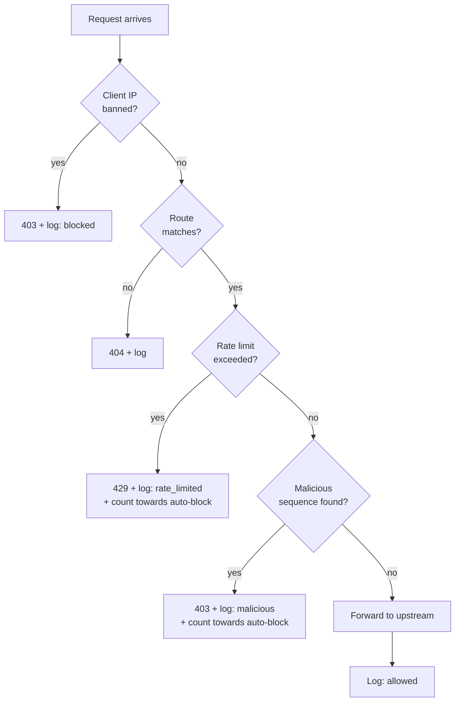
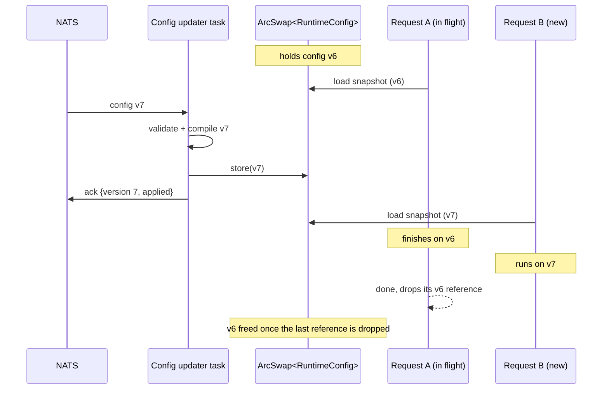

# Proxy configuration

> Status: design stage. This is the contract between the dashboard, the backend and the proxy. If the schema changes, all three change with it.

## 1. Overview

Each organisation has exactly one proxy configuration. It is:

- **Edited** in the dashboard by any member, co-owner or owner.
- **Validated** by the backend against the schema below, then saved to PostgreSQL with a new `version`.
- **Delivered** to the proxy over NATS (see [`architecture.md`](architecture.md#4-flow-config-update)).
- **Validated again** by the proxy before applying. The proxy never trusts the backend blindly, and a config that fails validation is rejected whole, never half-applied.

The config is a single JSON document. It describes **behaviour** (routes, limits, rules). It does not describe **state**, such as which IPs are currently banned. State is covered in [section 8](#8-bans-are-state-not-config).

### Message envelope

What actually travels over `org.<id>.config`:

```json
{
  "version": 7,
  "schema_version": 1,
  "config": { }
}
```

| Field | Meaning |
|---|---|
| `version` | The org's config version. The proxy ignores any version lower than or equal to the one it already runs. |
| `schema_version` | The version of this schema. Lets the proxy refuse a format it doesn't understand instead of misreading it. |
| `config` | The document described below. |

## 2. Request pipeline

Every request goes through the same steps, in this order. The order matters because it decides which rule wins and keeps the cheap checks first.



1. **Ban check.** A banned IP is rejected immediately, before any other work.
2. **Route match.** No matching route means `404`.
3. **Rate limit.** Done before inspection, so a flood is rejected cheaply without scanning every request.
4. **Malicious-sequence detection.** Only requests that passed the earlier steps are inspected.
5. **Forward** to the upstream and log the result.

Trusted IPs (see [section 7](#7-trusted-ips)) skip steps 3 and 4 and are never auto-banned. Manual bans still apply to them.

## 3. Full example

```json
{
  "client_ip": {
    "source": "connection"
  },
  "trusted_ips": ["203.0.113.10", "10.0.0.0/24"],
  "routes": [
    {
      "id": "users-api",
      "name": "Users API",
      "match": {
        "path_prefix": "/api/users",
        "methods": ["GET", "POST"]
      },
      "upstream": {
        "url": "https://users.internal.example.com",
        "timeout_ms": 10000
      },
      "strip_prefix": false,
      "rate_limit": {
        "requests": 30,
        "per": "minute"
      }
    },
    {
      "id": "everything-else",
      "name": "Main app",
      "match": { "path_prefix": "/" },
      "upstream": { "url": "https://app.internal.example.com" }
    }
  ],
  "rate_limit": {
    "enabled": true,
    "requests": 100,
    "per": "minute"
  },
  "detection": {
    "enabled": true,
    "action": "block",
    "inspect": ["path", "query", "headers", "body"],
    "max_body_bytes": 8192,
    "builtin": {
      "sql_injection": true,
      "path_traversal": true,
      "xss": true,
      "command_injection": true,
      "null_bytes": true
    },
    "custom_sequences": [
      {
        "name": "Block a known scanner string",
        "type": "text",
        "value": "sqlmap",
        "case_insensitive": true
      },
      {
        "name": "Suspicious byte pattern",
        "type": "hex",
        "value": "0d0a0d0a"
      }
    ]
  },
  "auto_block": {
    "enabled": true,
    "rules": [
      {
        "on": "rate_limit_exceeded",
        "threshold": 10,
        "window_seconds": 60,
        "ban_seconds": 900
      },
      {
        "on": "malicious_request",
        "threshold": 3,
        "window_seconds": 300,
        "ban_seconds": 86400
      }
    ]
  }
}
```

## 4. Routes (API mapping)

`routes` is an ordered list. For each request the proxy picks the **first route that matches**, so put specific routes before general ones. The dashboard lets users reorder routes.

| Field | Type | Required | Default | Description |
|---|---|---|---|---|
| `id` | string | yes | | Unique within the config. Letters, digits, `-`, `_`. Used in logs. |
| `name` | string | no | `id` | Human-friendly label shown in the dashboard. |
| `match.path_prefix` | string | yes | | Must start with `/`. A request matches if its path starts with this. |
| `match.methods` | string[] | no | all | HTTP methods this route accepts. Other methods on this path do not match and fall through to the next route. |
| `upstream.url` | string | yes | | `http://` or `https://` URL of the service to forward to. |
| `upstream.timeout_ms` | integer | no | `30000` | How long to wait for the upstream before returning `504`. |
| `strip_prefix` | boolean | no | `false` | If `true`, `match.path_prefix` is removed before forwarding. With prefix `/api/users`, a request to `/api/users/42` reaches the upstream as `/42`. |
| `rate_limit` | object | no | org default | Overrides the org-wide rate limit for this route only. |

**Examples of how mapping works**

| `path_prefix` | `strip_prefix` | Incoming path | Sent to upstream |
|---|---|---|---|
| `/api/users` | `false` | `/api/users/42` | `/api/users/42` |
| `/api/users` | `true` | `/api/users/42` | `/42` |
| `/` | `false` | `/health` | `/health` |

If the upstream URL itself has a path (for example `https://host/v2`), the forwarded path is appended to it.

The proxy adds the standard `X-Forwarded-For`, `X-Forwarded-Host` and `X-Forwarded-Proto` headers so upstreams can see the original client.

## 5. Rate limiting

| Field | Type | Default | Description |
|---|---|---|---|
| `rate_limit.enabled` | boolean | `true` | Turns org-wide rate limiting on or off. |
| `rate_limit.requests` | integer | `100` | Requests allowed per window, per client IP. |
| `rate_limit.per` | `"second"`, `"minute"` or `"hour"` | `"minute"` | Window size. |

- Limits are tracked **per client IP**, **per route** (a route with its own `rate_limit` has a separate counter from the org-wide one).
- A route-level `rate_limit` replaces the org-wide one for that route. It does not stack with it.
- When the limit is exceeded, the proxy answers `429 Too Many Requests` with a `Retry-After` header and logs `action = rate_limited`.
- Counters live in the proxy's memory and reset when the proxy restarts.

## 6. Malicious byte-sequence detection

Basic by design: it catches the obvious attack patterns, not everything. It is not a replacement for a real web application firewall.

| Field | Type | Default | Description |
|---|---|---|---|
| `detection.enabled` | boolean | `true` | Master switch. |
| `detection.action` | `"block"` or `"log"` | `"block"` | `block` answers `403` and logs `action = malicious`. `log` forwards the request normally but still logs it, which is useful for trying rules out before enforcing them. |
| `detection.inspect` | string[] | `["path","query","headers","body"]` | Which parts of the request to scan. |
| `detection.max_body_bytes` | integer | `8192` | Only this many bytes from the start of the body are scanned. Larger bodies are still forwarded in full. |
| `detection.builtin` | object | all `true` | Toggles for the built-in pattern sets below. |
| `detection.custom_sequences` | object[] | `[]` | User-defined sequences. |

### Built-in pattern sets

| Key | Catches (at a basic level) |
|---|---|
| `sql_injection` | Common SQL injection fragments such as `' OR 1=1`, `UNION SELECT`, comment terminators |
| `path_traversal` | `../`, `..\`, and their URL-encoded forms |
| `xss` | `<script`, `javascript:`, inline event handlers like `onerror=` |
| `command_injection` | Shell metacharacter chains such as `; rm`, `&& cat`, `` `...` `` and `$(...)` |
| `null_bytes` | `%00` and raw `0x00` bytes |

The exact patterns ship with the proxy and are not editable by users. Users switch sets on or off, and add their own sequences.

### Custom sequences

| Field | Type | Required | Default | Description |
|---|---|---|---|---|
| `name` | string | yes | | Shown in logs as the `rule` that triggered. |
| `type` | `"text"` or `"hex"` | yes | | How `value` is interpreted. |
| `value` | string | yes | | The sequence. For `hex`, an even number of hex digits (for example `0d0a0d0a`). |
| `case_insensitive` | boolean | no | `false` | Only applies to `text`. |

A custom sequence is a **literal match**, not a regular expression. This is deliberate: it keeps the feature easy to understand and avoids regex patterns that could slow the proxy down.

## 7. Trusted IPs

`trusted_ips` is a list of IP addresses or CIDR ranges (IPv4 or IPv6).

- Trusted clients **skip rate limiting and detection** and are **never auto-banned**.
- It exists mainly so an org can't accidentally lock out its own office, CI runner or monitoring.
- A manual ban still applies to a trusted IP, since that is a deliberate action.

### Client IP source

| Field | Values | Default | Description |
|---|---|---|---|
| `client_ip.source` | `"connection"`, `"x_forwarded_for"` | `"connection"` | Where the proxy reads the client IP from. |

Use `x_forwarded_for` only if Proxyma itself sits behind another trusted proxy or load balancer. Otherwise a client could fake the header to dodge rate limits and bans, which is why `connection` is the default.

## 8. Bans are state, not config

Which IPs are banned right now is **not** part of this document. Bans change constantly (an auto-block can happen at any moment), and they have their own lifecycle, so they are kept in the database and loaded by the proxy into memory.

What *is* config is the **policy** that creates automatic bans:

### Auto-block rules

| Field | Type | Default | Description |
|---|---|---|---|
| `auto_block.enabled` | boolean | `true` | Master switch. |
| `auto_block.rules[]` | object[] | see below | Evaluated independently of each other. |
| `rules[].on` | `"rate_limit_exceeded"` or `"malicious_request"` | | The violation this rule counts. |
| `rules[].threshold` | integer | | Violations needed to trigger the ban. |
| `rules[].window_seconds` | integer | | The violations must happen within this time. |
| `rules[].ban_seconds` | integer or `null` | | How long the ban lasts. `null` means permanent until someone removes it manually. |

**Example reading:** `{ "on": "rate_limit_exceeded", "threshold": 10, "window_seconds": 60, "ban_seconds": 900 }` means *"an IP that hits the rate limit 10 times within 60 seconds is banned for 15 minutes."*

**Defaults** if the user enables auto-block without touching the rules: the two rules from the example above.

> Which IPs are banned right now is **not** part of this document. Bans change constantly and have their own lifecycle: PostgreSQL holds them, JetStream delivers them, and the proxy keeps an in-memory copy that is rebuilt from JetStream on every start. See "Flow: IP bans" in [`architecture.md`](architecture.md).

## 9. Defaults for a new organisation

When an org is created, it starts with a safe, working config so the proxy is usable straight away:

```json
{
  "client_ip": { "source": "connection" },
  "trusted_ips": [],
  "routes": [],
  "rate_limit": { "enabled": true, "requests": 100, "per": "minute" },
  "detection": {
    "enabled": true,
    "action": "log",
    "inspect": ["path", "query", "headers", "body"],
    "max_body_bytes": 8192,
    "builtin": {
      "sql_injection": true,
      "path_traversal": true,
      "xss": true,
      "command_injection": true,
      "null_bytes": true
    },
    "custom_sequences": []
  },
  "auto_block": { "enabled": false, "rules": [] }
}
```

- With **no routes**, every request gets `404`. The user adds their first route to start proxying.
- Detection starts in **`log`** mode and auto-block starts **off**, so a new user can watch what would be caught before anything starts blocking real traffic.

## 10. Validation rules

The backend and the proxy enforce the same rules. A config that breaks any of them is rejected.

| Rule | Limit |
|---|---|
| Max routes | 50 |
| Max custom sequences | 100 |
| Max trusted IPs | 100 |
| Max auto-block rules | 10 |
| Route `id` | Unique, 1 to 64 characters, `[A-Za-z0-9_-]` |
| `path_prefix` | Starts with `/`, max 256 characters |
| `upstream.url` | Valid `http` or `https` URL, with a host |
| `upstream.timeout_ms` | 100 to 120000 |
| `rate_limit.requests` | 1 to 1,000,000 |
| `detection.max_body_bytes` | 0 to 65536 |
| Custom sequence `value` | 1 to 256 characters (`hex` must be an even number of valid hex digits) |
| Auto-block `threshold` | 1 to 10,000 |
| Auto-block `window_seconds` | 1 to 86,400 |
| Auto-block `ban_seconds` | 1 to 2,592,000 (30 days), or `null` |
| Unknown fields | Rejected, to catch typos early |

### Rejection format

When the proxy rejects a config, its ack carries every problem it found, each pointing to the field responsible, so the dashboard can highlight it:

```json
{
  "version": 7,
  "status": "rejected",
  "errors": [
    { "path": "/routes/1/upstream/url", "message": "must be a valid http or https URL" },
    { "path": "/detection/custom_sequences/0/value", "message": "hex value must have an even number of digits" }
  ]
}
```

`path` is a [JSON Pointer](https://datatracker.ietf.org/doc/html/rfc6901) into the config document.

## 11. Evolving the schema

- Adding an **optional field with a default** does not need a new `schema_version`. Old configs stay valid.
- Renaming, removing or changing the meaning of a field **bumps** `schema_version`. The backend migrates stored configs on upgrade, and a proxy that sees a `schema_version` newer than it understands rejects the config instead of guessing.

## 12. Applying a config without a restart

A proxy **never restarts to apply a config**. A new config takes effect while the proxy keeps serving traffic. Requests already in progress finish on the config they started with, and new requests use the new one.

### How it works

1. The proxy receives a config message from NATS.
2. It **validates** it against the schema and the limits in section 10.
3. It **compiles** it into an immutable runtime structure: the route table, rate-limit settings, the detection matcher and the trusted-IP set.
4. If validation or compilation fails, it sends a `rejected` ack and keeps the current config untouched.
5. If it succeeds, it **atomically swaps** the new structure in with [`ArcSwap`](https://docs.rs/arc-swap), then sends an `applied` ack.



### Rules the proxy follows

| Rule | Why |
|---|---|
| **One snapshot per request.** A request takes a snapshot when it enters the pipeline and uses that same snapshot for every step (route match, rate limit, detection, forwarding). | A request never sees a half-old, half-new config. |
| **Snapshot per request, not per connection.** On a keep-alive connection, each new request takes a fresh snapshot. | A long-lived connection can't keep an org on an old config forever. |
| **Hold a full reference, not a short-lived guard.** Use `load_full()` (an owned `Arc`) for the duration of a request, since the cheaper `load()` guard is meant for very short use. | Avoids degrading `ArcSwap` when many slow requests are in flight. |
| **Compile before swapping.** Everything expensive, such as building the detection matcher, happens before the swap, off the request path. | The swap itself is a single pointer exchange, so requests are never blocked. |
| **Swap or nothing.** A config is applied completely or not at all. | Matches the ack: `applied` means the swap happened. |
| **Latest wins.** If several versions are waiting, the updater only compiles the newest. | Rapid edits don't pile up compile work. |
| **Ignore old versions.** A version lower than or equal to the current one is ignored. | Makes redelivery harmless. |

### What survives a swap

The config snapshot is immutable and replaced wholesale, so anything that has to persist across swaps lives **outside** it, in separate shared state:

| State | Behaviour on config change |
|---|---|
| **Rate-limit counters** | Kept, keyed by route `id` and client IP. New limits apply to the existing counters. Counters of routes that no longer exist are evicted. |
| **Ban set** | Kept. It has its own lifecycle (see [`architecture.md`](architecture.md)) and is not part of the config. |
| **Upstream connection pools** | Kept and shared, so a swap doesn't drop warm connections. Pools for upstreams that disappeared from the config are closed after they go idle. |
| **In-flight requests** | Finish on the snapshot they started with. |

If counters lived inside the snapshot, every config edit would reset all rate limits, which would let a client get a fresh allowance by waiting for someone to edit the config.

### What "applied" means

`applied` means the new config has been **swapped in**: every request that *starts* after that moment uses it. Requests that started earlier may still be finishing on the previous version, for at most as long as the longest upstream timeout (up to 120 seconds). The old config is freed when the last of those requests ends.

### Which changes apply live

Everything in this config applies live, since routes, limits, detection and auto-block rules are all read from the snapshot. Anything that would need a listener rebuilt, such as the listening port or TLS certificates, is **not** part of this config (see section 13), and if it is added in future it will need its own reload strategy.

### Knowing which version handled a request

Each log entry records the `config_version` it ran under. This makes it easy to answer "was this request handled before or after my change?" and shows the swap point in the log stream. The proxy's heartbeat also reports its current `config_version`, so the dashboard can show which version each proxy is actually running.

## 13. Not in the MVP

Deliberately left out to keep the project small and the config easy to understand:

- Regex-based detection rules
- Per-route detection settings
- Header rewriting, redirects and response modification
- TLS termination and custom certificates
- Load balancing across several upstreams
- Authentication or API-key checks at the proxy
- Country or ASN based blocking
