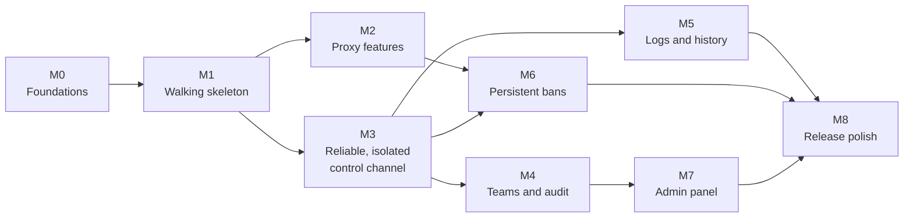

# Roadmap

> Status: design stage. Nothing is built yet, so every item is 📝 planned. Update the markers as work moves forward.

Legend: ✅ done · 🚧 in progress · 📝 planned

## 1. Approach

The riskiest part of Proxyma isn't any one component, it's getting **all of them to work together**: backend, Docker, NATS, proxy, ClickHouse and dashboard. So the plan builds a **thin end-to-end version first** (a "walking skeleton"), then makes each part deeper and more robust. That way integration problems show up in week one, not in the last month.

Milestones are ordered by dependency, not by date. Add target dates once the deadline is known.

M2 (proxy work) and M3 (backend and messaging work) can run in parallel once M1 exists.

## 2. What "MVP" means

The MVP is done when someone can run the project locally and do all of this:

1. Register, log in and create an organisation.
2. See their proxy start automatically in its own container.
3. Map an API route, set a rate limit and turn on detection and auto-blocking from the dashboard, and watch the change apply **without a restart**.
4. Send traffic through the proxy and watch the requests appear live.
5. Search the last 30 days of logs.
6. See an abusive IP get banned automatically, **survive a proxy restart**, and be unbanned from the dashboard.
7. Invite a teammate, give them a role, and see who changed what in the audit trail.

Milestones M0 to M6 deliver that. M7 and M8 are the admin panel and polish.

## 3. Milestones

### M0: Foundations

**Goal:** a clean repo where everything can be started with one command.

- 📝 `LICENSE` (MIT), `.gitignore` covering all three stacks, empty `proxy/`, `backend/`, `frontend/` and `docs/` folders
- 📝 Placeholder files for every doc linked from the README
- 📝 Root `docker-compose.yml` running PostgreSQL, ClickHouse and NATS (JetStream enabled)
- 📝 Basic CI per component (build and test on every push)
- 📝 Shared test cases for config validation, used by both the Kotlin and Rust validators (see [`proxy-config.md`](proxy-config.md))

**Done when:** `docker compose up -d` starts the three services and CI is green on empty projects.

### M1: Walking skeleton

**Goal:** the smallest possible version of the whole flow, with every piece real but minimal.

- 📝 **Proxy:** forwards requests for one configured route, receives config from NATS, publishes basic log entries
- 📝 **Backend:** register and login, create an org, start a proxy container with `docker-java`, publish a config, consume logs
- 📝 **Dashboard:** login, a "create org" button, a plain config editor for routes, and a live log list over SSE
- 📝 Shortcuts allowed here: shared NATS credentials, no acks, no history, no roles

**Done when:** creating an org starts a container, adding a route in the dashboard makes the proxy forward traffic, and the requests show up live in the browser.

This is the most important milestone. Everything after it is improving a system that already works end to end.

### M2: Proxy features

**Goal:** the proxy does what the product promises. Can be built with a local JSON file for config, independent of the backend.

- 📝 Route matching: first match wins, path prefix, methods, `strip_prefix`, timeouts, forwarded headers
- 📝 **Hot reload with `ArcSwap`**: validate, compile, swap, one snapshot per request, state kept outside the snapshot (see [`proxy-config.md`](proxy-config.md#12-applying-a-config-without-a-restart))
- 📝 Rate limiting, with global and per-route limits, bounded counter storage and counters that survive a swap
- 📝 Malicious byte-sequence detection: built-in sets, custom text and hex sequences, `block` and `log` modes
- 📝 Trusted IPs and client IP source
- 📝 Auto-block rules feeding an in-memory ban set (persistence comes in M6)
- 📝 Upstream rules: `localhost` mapping, deny list, address check at connect time
- 📝 Request hardening: header and body limits, timeouts, hop-by-hop header handling
- 📝 Config validation matching [`proxy-config.md`](proxy-config.md#10-validation-rules), with JSON Pointer errors

**Done when:** the full example config from `proxy-config.md` works, a config can be swapped under load without failed requests, and a simple load test shows the proxy is stable.

### M3: Reliable, isolated control channel

**Goal:** config reaches the proxy dependably, and orgs can't touch each other. Security work belongs here, not at the end.

- 📝 Config storage with `version`, `published_version` and `applied_version`
- 📝 Proxy acks (`applied` or `rejected` with errors), shown in the dashboard as pending, applied or rejected
- 📝 `If-Match` handling for concurrent edits, dry-run validation endpoint
- 📝 Retry job for unpublished configs
- 📝 JetStream streams and consumers as in [`architecture.md`](architecture.md#8-nats-subject-layout), with a proxy that loads its latest config on start
- 📝 **Per-org NATS credentials** (JWT users with scoped permissions and inbox prefix), replacing the M1 shortcut
- 📝 Container hardening, resource limits, labels and port allocation
- 📝 Heartbeats, org states, and the **reconciliation loop**
- 📝 Org deletion with cleanup
- 📝 **Cross-org isolation tests** that try to read, write and subscribe across org boundaries and must fail

**Done when:** killing a proxy, the backend or NATS in turn and restarting each leaves the system consistent, and the isolation tests pass.

### M4: Teams and audit

**Goal:** several people can safely manage one proxy.

- 📝 Memberships, the owner, co-owner and member roles and the rules around them
- 📝 Invitations (hashed single-use tokens, expiry, share-by-link)
- 📝 One owned org per user, membership in many, and the org switcher in the dashboard
- 📝 Append-only audit trail written in the same transaction as each change, plus the dashboard view
- 📝 Refresh-token rotation and logout, as in [`proxyma-security.md`](proxyma-security.md#3-authentication)
- 📝 Rate limits on the backend API
- 📝 Permission tests for every endpoint and role

**Done when:** each cell of the role table is covered by an automated test, and every change appears in the audit trail.

### M5: Logs and history

**Goal:** a live view and searchable history that don't depend on each other.

- 📝 Proxy log publishing with the entry shape from [`architecture.md`](architecture.md#5-flow-log-pipeline), including `config_version`
- 📝 Backend consumers: live fan-out and the batch writer into ClickHouse
- 📝 ClickHouse table with a 30-day TTL
- 📝 `GET /logs` with filters and keyset pagination
- 📝 The SSE ticket and the single `/stream` endpoint, with the dashboard backfilling gaps after a reconnect
- 📝 Dashboard log viewer with filters
- 📝 `GET /logs/stats` and simple charts (can be cut, see section 5)

**Done when:** the live view keeps working while ClickHouse is stopped, and the history is complete again after it restarts.

### M6: Persistent bans

**Goal:** bans that survive restarts, with the proxy still never touching a database.

- 📝 `bans` table, the `BANS` KV bucket and the `events.ban` subject
- 📝 Proxy: load bans before serving traffic, watch for changes, report automatic bans
- 📝 Backend: persist events, write KV, scheduled expiry, and the reconciliation duty for bans
- 📝 Manual ban and unban API and dashboard view
- 📝 The 10,000 ban cap

**Done when:** an auto-banned IP is still blocked after the proxy restarts, and a manual unban takes effect on a running proxy.

### M7: Admin panel

**Goal:** operators can see and moderate the platform. Details in [`proxyma-security.md`](proxyma-security.md#14-platform-administration).

- 📝 Platform admin flag, operator `grant-admin` and `revoke-admin` commands, disabled by default
- 📝 Read-only user and org search and detail views, and platform stats
- 📝 Suspend, unsuspend and force logout with password re-entry and reasons
- 📝 Platform audit trail and the matching entries in org audit trails
- 📝 Tests proving every admin endpoint rejects normal users and never returns config, logs or secrets

**Done when:** an admin can find a user, suspend them, and the affected orgs show the event while their proxies keep running.

### M8: Release polish

**Goal:** a project other people can understand and run.

- 📝 Make `docker compose up` the single start-up path for everything except the code you're developing
- 📝 Check that every doc matches the real behaviour, and update status markers in the README
- 📝 Screenshots, a short demo recording, and the final architecture diagram
- 📝 A load test and its results in the docs
- 📝 `CONTRIBUTING.md`, `SECURITY.md`, issue and PR templates
- 📝 Dependency audit (`cargo audit`, Gradle and Bun checks)
- 📝 A walkthrough of the MVP checklist in section 2 from a clean machine

**Done when:** someone who has never seen the project can follow the README to a working install.

## 4. Testing along the way

- **Proxy:** unit tests for routing, matching, rate limiting and detection. Integration tests that swap config under load.
- **Backend:** integration tests with Testcontainers for PostgreSQL, ClickHouse and NATS.
- **Isolation and permissions:** automated tests that act as the wrong user or the wrong org and must be refused.
- **Failure tests:** stop each dependency in turn and check the behaviour described in [`architecture.md`](architecture.md#10-failure-behaviour).
- **Shared config test cases:** one set of valid and invalid configs checked by both validators.

## 5. If time runs short

Cut in this order, keeping the core story (isolated proxies, hot reload, live logs, persistent bans) intact:

1. Log statistics and charts (`GET /logs/stats`)
2. Config history and restore
3. Admin panel (M7), or reduce it to read-only
4. Log filters beyond time range and action
5. Custom detection sequences (keep the built-in sets)
6. Co-owner role (keep owner and member)

Don't cut: the walking skeleton, hot reload, acks, per-org credentials, the reconciliation loop, persistent bans, or the isolation tests. Those are what make the project a distributed-systems project rather than a CRUD app.

## 6. After the MVP

Ideas that are deliberately out of scope for now, collected from the other docs:

- Two-factor authentication for admins and users
- Email invitations, email verification and password reset
- Ownership transfer and account deletion
- Admin actions: restart a proxy, delete an org
- CIDR-range bans
- TLS termination and custom certificates
- Regex-based detection rules and per-route detection settings
- Header rewriting, redirects and load balancing across upstreams
- Metrics endpoints (such as Prometheus) and alerting
- A NATS account per org for stronger isolation
- A transactional outbox for config publishing
- Running several backend instances
- Log export
- API keys for scripted access
